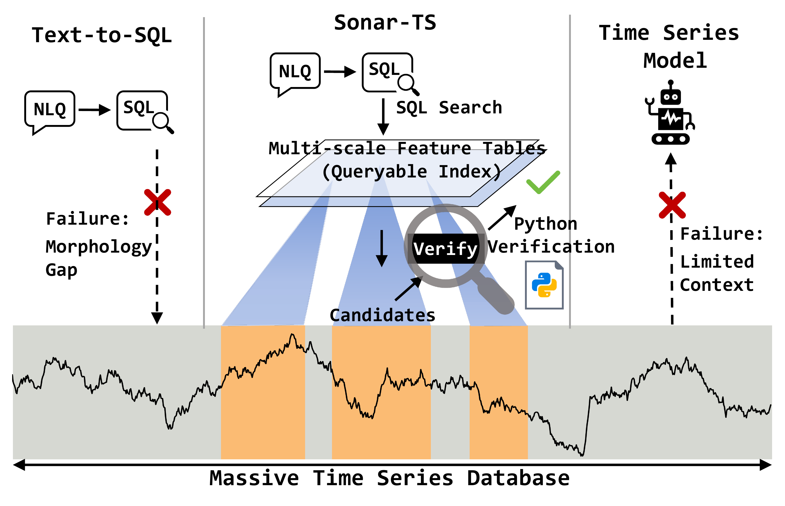
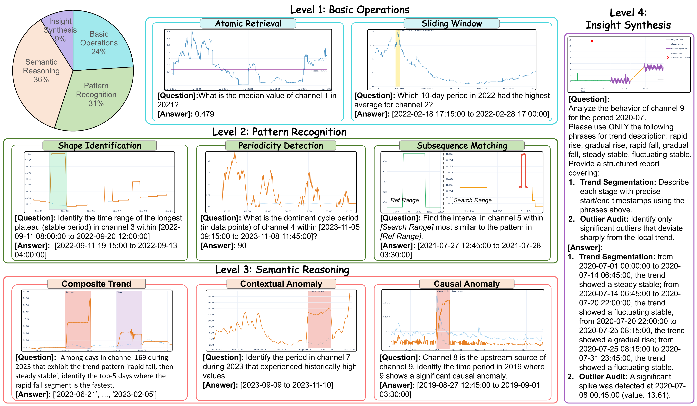
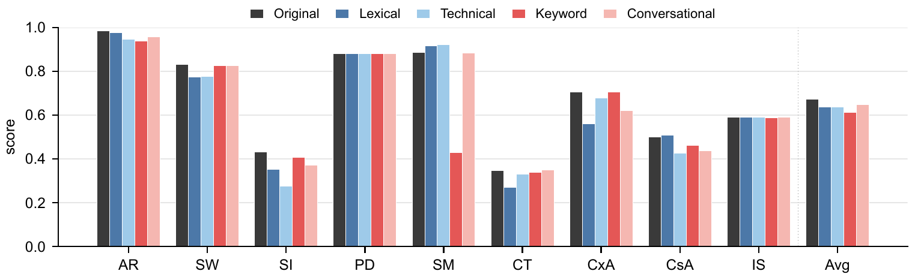
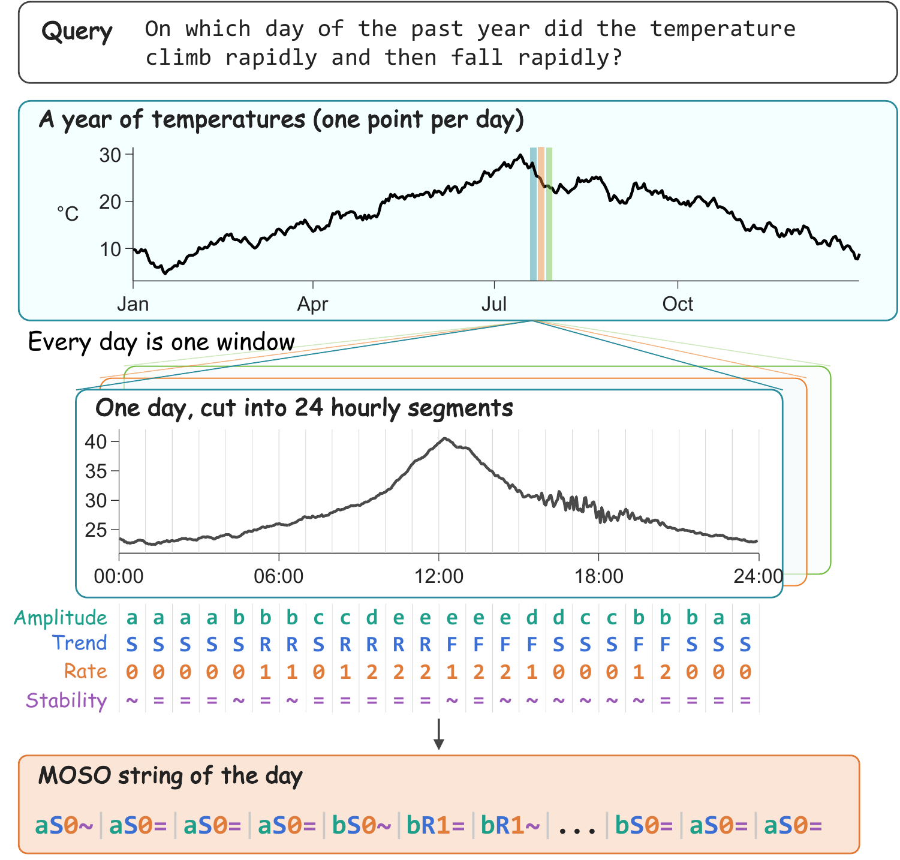

<h1 align="center">Sonar-TS: Natural Language Querying over Time Series Databases with Grounded Morphological Symbolization</h1>

<p align="center">
  <a href="https://arxiv.org/abs/2602.17001"></a>
  <a href="https://proceedings.mlr.press/v306/tan26h.html"></a>
  <a href="https://huggingface.co/spaces/mrtan/Sonar-TS-Demo"></a>
  <a href="https://huggingface.co/datasets/mrtan/NLQTSBench"></a>
  <a href="LICENSE"></a>
</p>

<p align="center">
  <b>Official implementation of the journal version of Sonar-TS</b> (branch <code>moso</code>).<br>
  The conference version (ICML 2026) lives on the <a href="https://github.com/Atlamtiz/Sonar-TS/tree/main"><code>main</code></a> branch.
</p>

## 📖 Introduction

Time series databases (TSDBs) store years of readings from sensors, markets and servers, and the questions users ask about them are about shape: *on which days did the level rise rapidly and then fall slowly*, *where is the longest plateau*, *which week behaved abnormally*. We call this problem **Natural Language Querying for Time Series Databases (NLQ4TSDB)**. Text-to-SQL cannot express a shape, and time series models that read the raw signal cannot read a history of millions of points.

<p align="center">
  
</p>

**Sonar-TS** answers a query by *search, then verify*. Offline, the raw series is summarised into multi-scale feature tables, each window carrying statistics and a symbolic string of its shape. Online, an LLM planner turns the query into a search over those tables, and an LLM generator writes a script that verifies every candidate on the raw data. The LLM never reads the series itself, so the cost of a query does not grow with the history.

This version extends the conference paper in three ways:

* **MOSO**, a grounded morphological symbolization whose symbols say what a user says about a shape (see [MOSO](#-moso-grounded-morphological-symbolization)).
* **A skill library selected per query**, built offline by *Prompt Cold Start* and read by the planner (see [Prompt Cold Start](#-prompt-cold-start-and-the-skill-library)).
* **NLQTSBench-Styles** and **NLQTSBench-Lite**, two variants of the benchmark for robustness to phrasing and for models that read the series directly (see [Benchmarks](#%EF%B8%8F-benchmarks)).

## 🗂️ Benchmarks

**NLQTSBench** has 1,153 queries over real series (CausalRivers, ETTm1, SMD) at four levels: basic operations, pattern recognition, semantic reasoning and insight synthesis. Every query has a verifiable ground truth: the series of Levels 2 to 4 contain a shape injected at a known place, and Level 1 is answered on the raw series as it is.

<p align="center">
  
</p>

**NLQTSBench-Styles** rewrites every query in four linguistic styles, lexical, technical, keyword and conversational, with the answer key unchanged. Each rewrite was produced by an LLM against a specification and admitted by a deterministic checker plus an LLM judge; the full provenance is released.

<p align="center">
  
</p>

| Benchmark | Where | Queries | Format |
| --- | --- | --- | --- |
| NLQTSBench | `nlqtsbench/tasks.json` | 1,153 | one record per query; raw CSVs from [HuggingFace](https://huggingface.co/datasets/mrtan/NLQTSBench) via `scripts/download_dataset.py` |
| NLQTSBench-Styles | `nlqtsbench/styles/nlqtsbench_styles.json` | 1,153 × 4 | the same records with a `question_styles` field; `styles_provenance.json`, `STYLE_SPEC.md`, `JUDGE_SPEC.md` |
| NLQTSBench-Lite | `nlqtsbench/lite/` | 500 | short-context queries in the same format, series included (`ts_data/`) |

The task format and the five metrics are described in [`nlqtsbench/README.md`](nlqtsbench/README.md).

## 🔍 The Sonar-TS framework

<p align="center">
  
</p>

1. **Offline data processing** builds three feature tables per channel, with one row per day, month and year. A row carries the window's statistics (min, max, mean, standard deviation, slope) and its MOSO string, so that a shape can be searched with SQL.
2. **Online querying** runs two LLM calls. The *Task Planner* reads the schema, the index guide and the skills that apply, and writes a plan of sub-steps. The *Code Generator* turns the plan into one Python script that first *searches* the feature tables (SQL, a regular expression over the MOSO strings) and then *verifies* the candidates on the raw data. The script is executed in a sandbox; a failed run is fed back to the generator for one self-correction.
3. **Prompt Cold Start** (the purple loop) builds the skill library offline from a stream of training queries: answers are scored, failures are reflected upon, a skill is drafted or patched, and a *skill gate* admits it only if it raises the score on held-out queries. At query time the planner selects the skills a query needs, so the prompt stays the size of one skill however large the library grows.
4. **Post-processing** turns the verified result into an answer, a summary and, on request, a figure.

## 🔤 MOSO: grounded morphological symbolization

MOSO writes every segment of a window as a four-character token, one character per slot:

| Slot | Characters | Meaning |
| --- | --- | --- |
| amplitude | `a` … `e` | the level of the segment relative to the window |
| trend | `R` `F` `S` | rising, falling, stable |
| rate | `0` `1` `2` | not moving, slow, rapid |
| stability | `=` `~` | steady, fluctuating |

The degrees are *grounded*: whether a segment counts as moving, rapid or fluctuating is decided by comparing it with the other segments of its window and with the channel's history, not by a fixed threshold, so that "rapid" means rapid for that day and that channel. The slots are the things people say about a shape, which is what lets a query be translated into a pattern over the strings.

<p align="center">
  
</p>

A query such as *rapid rise, then slow rise, then steady stable* becomes a regular expression over the `sym` column of a feature table (`(?:[a-e]R2[=~])+ … (?:[a-e]R1[=~])+ … (?:[a-e]S0=){2,}`), which the search runs with `REGEXP` in SQL; the verification then measures the exact slopes and boundaries on the raw data. The implementation is [`sonar_ts/symbolize.py`](sonar_ts/symbolize.py), the codebook that teaches the LLM to read and search the strings is [`sonar_ts/prompts/codebook_moso.txt`](sonar_ts/prompts/codebook_moso.txt), and the same file implements SAX, 1d-SAX and TFSAX for comparison.

## 🧠 Prompt Cold Start and the skill library

[`cold_start_stream/`](cold_start_stream/) distills skills from training queries without labels at run time: `run.py` streams the queries through the reflect-draft-review loop, `select.py` picks the library with the best validation score, and `eval.py` evaluates a library on a benchmark. The six skills used in the paper are in [`sonar_ts/skills/library/`](sonar_ts/skills/library/), one Markdown document each; the planner reads their descriptions and names the ones a query needs.

```bash
python -m cold_start_stream.run --help
python -m cold_start_stream.select --help
python -m cold_start_stream.eval --help
```

## 🚀 Quick start

### 1. Install

```bash
git clone -b moso https://github.com/Atlamtiz/Sonar-TS.git
cd Sonar-TS
conda create -n sonarts python=3.11 -y && conda activate sonarts
pip install -r requirements.txt
```

### 2. Data and API key

```bash
python scripts/download_dataset.py                       # raw CSVs -> nlqtsbench/ts_data/ (~1.7 GB)
cp -n configs/deepseek_api-key.txt.example configs/deepseek_api-key.txt
$EDITOR configs/deepseek_api-key.txt                     # one key per line; set concurrency.workers in configs/online.yaml to the number of keys
```

### 3. Build the databases and the feature tables

```bash
python -m scripts.load_benchmark        # CSV -> one SQLite database per task
python -m scripts.build_index           # statistics, SAX string (`sax`) and MOSO string (`sym`) per window
```

### 4. Run

```bash
python main.py
```

The defaults are the configuration of the paper: MOSO in the `sym` column, the codebook in `sonar_ts/prompts/`, the six skills in `sonar_ts/skills/library/`. Useful flags: `--limit N`, `--workers N`, `--tasks`, `--databases`, `--out-dir`, `--figures` (`python main.py --help`). The conference configuration, SAX in the `sax` column, is three variables away:

```bash
SONAR_SYMBOLIZATION=sax SONAR_SYMBOL_COLUMN=sax SONAR_INDEX_GUIDE_DIR=sonar_ts/prompts_sax python main.py
```

### 5. Reproduce the main results

One script runs the steps above and averages three runs into the Sonar-TS row of the main results table:

```bash
bash scripts/reproduce_main_results.sh                   # three runs, about 25 minutes each with 16 keys
LIMIT=20 RUNS=1 bash scripts/reproduce_main_results.sh   # smoke test
```

The runs are written to `runs/main/r1..r3` (`records.jsonl` per task, `table.md` per run); `scripts/aggregate_runs.py` prints the per-task, per-level and overall scores averaged over the runs.

### 6. Styles and Lite

```bash
# one linguistic style of NLQTSBench-Styles, on the same databases
python scripts/make_style_tasks.py --style conversational
python main.py --tasks nlqtsbench/styles/tasks_conversational.json

# NLQTSBench-Lite: the same three steps on another benchmark directory
export SONAR_BENCHMARK_DIR=nlqtsbench/lite SONAR_DATABASES_DIR=databases_lite
python -m scripts.load_benchmark && python -m scripts.build_index
python main.py --tasks nlqtsbench/lite/tasks.json --databases databases_lite
```

## 📁 Project structure

```
Sonar-TS (moso)
├── main.py                         run the benchmark
├── configs/                        online.yaml (LLM, executor, concurrency), offline.yaml (feature tables), API-key template
├── sonar_ts/
│   ├── pipeline.py                 planner -> generator -> executor, with self-correction
│   ├── planner.py, generator.py, executor.py, evaluator.py, llm.py, schema.py, storage.py
│   ├── offline.py                  feature tables: statistics, SAX and MOSO strings
│   ├── symbolize.py                MOSO (and SAX, 1d-SAX, TFSAX)
│   ├── index_guide.py              composes the index guide: shared text + the codebook of the symbolization
│   ├── prompts/                    planner and generator templates, MOSO codebook (default), index text
│   ├── prompts_sax/                SAX codebook and index text of the conference configuration
│   ├── skills/                     skill loader and library/ with the six skills
│   └── postprocess/                answer formatting and figures
├── cold_start_stream/              Prompt Cold Start: run.py, select.py, eval.py, agents and prompts
├── scripts/                        download_dataset, load_benchmark, build_index, make_style_tasks,
│                                   reproduce_main_results.sh, aggregate_runs.py, render_samples
├── nlqtsbench/                     tasks.json, styles/, lite/, README.md
└── docs/figures/
```

## 📑 Citation

```bibtex
@inproceedings{tan2026sonarts,
  title     = {{Sonar-TS}: Search-Then-Verify Natural Language Querying for Time Series Databases},
  author    = {Tan, Zhao and Zhao, Yiji and Wang, Shiyu and Xu, Chang and Liang, Yuxuan and Liu, Xiping and Pan, Shirui and Jin, Ming},
  booktitle = {International Conference on Machine Learning},
  pages     = {118668--118690},
  year      = {2026},
  url       = {https://proceedings.mlr.press/v306/tan26h.html}
}
```

## 🏛️ Affiliations

<p align="center">
  
  
  
  
  
  
</p>
