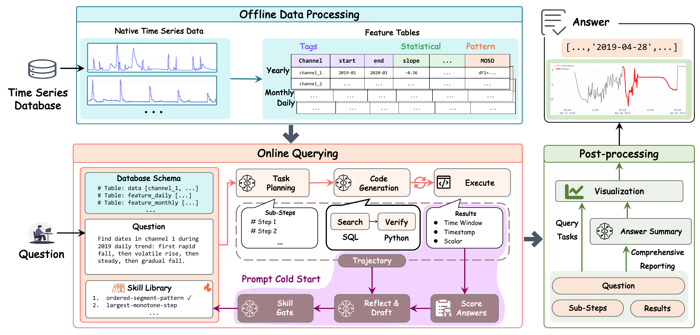

<h1 align="center">Sonar-TS: Natural Language Querying over Time Series Databases with Grounded Morphological Symbolization</h1>

<p align="center">
  <a href="https://arxiv.org/abs/2602.17001"></a>
  <a href="https://proceedings.mlr.press/v306/tan26h.html"></a>
  <a href="https://huggingface.co/spaces/mrtan/Sonar-TS-Demo"></a>
  <a href="https://huggingface.co/datasets/mrtan/NLQTSBench"></a>
  <a href="LICENSE"></a>
</p>

<p align="center">
  <b>This branch (<code>vldbj</code>) holds the extended journal version of Sonar-TS.</b><br>
  The <code>main</code> branch holds the ICML 2026 conference version.
</p>

## 📖 Introduction

Natural Language Querying for Time Series Databases (NLQ4TSDB) lets a user ask a time series database for shapes, anomalies, periods and trends in plain language, over histories that a language model cannot read. Sonar-TS answers such a query by *search, then verify*: a planner turns the query into a search over symbolic feature tables that are built offline, and a generator writes a script that verifies every candidate on the raw data.

<p align="center">
  
</p>

## ✨ What this version adds

* **MOSO**, a grounded morphological symbolization. Every segment of a window becomes a four-tuple ⟨amplitude, trend, rate, stability⟩ whose degrees (rapid, slow, steady, fluctuating) are decided relative to the window and the channel's history, so that the words of a query map onto the symbols of the index. Implementation: [`sonar_ts/symbolize.py`](sonar_ts/symbolize.py); the codebook that tells the LLM how to search it: [`sonar_ts/prompts/codebook_moso.txt`](sonar_ts/prompts/codebook_moso.txt). MOSO is the default configuration of this branch.
* **A skill library selected per query.** *Prompt Cold Start* ([`cold_start_stream/`](cold_start_stream/)) distills skills from training queries without labels at run time, admits a skill only if it raises the score on held-out queries, and the planner selects the skills a query needs. The six skills used in the paper are in [`sonar_ts/skills/library/`](sonar_ts/skills/library/).
* **NLQTSBench-Styles** ([`nlqtsbench/styles/`](nlqtsbench/styles/)): every query of NLQTSBench rewritten in four linguistic styles (lexical, technical, keyword, conversational) with the answer key unchanged.
* **NLQTSBench-Lite** ([`nlqtsbench/lite/`](nlqtsbench/lite/)): 500 short-context queries in the same format, for time series models that read the series directly.

## 🗂️ Benchmarks

| Benchmark | Where | Queries | Notes |
| --- | --- | --- | --- |
| NLQTSBench | `nlqtsbench/tasks.json` | 1,153 | 4 levels, 9 tasks; raw CSVs from [HuggingFace](https://huggingface.co/datasets/mrtan/NLQTSBench) via `scripts/download_dataset.py` |
| NLQTSBench-Styles | `nlqtsbench/styles/nlqtsbench_styles.json` | 1,153 × 4 styles | `question_styles` per task; `styles_provenance.json` keeps every rewrite attempt and the judge's verdict; the rewriting and judging specifications are `STYLE_SPEC.md` and `JUDGE_SPEC.md` |
| NLQTSBench-Lite | `nlqtsbench/lite/tasks.json` + `nlqtsbench/lite/ts_data/` | 500 | self-contained, same task format |

See [`nlqtsbench/README.md`](nlqtsbench/README.md) for the task format and the metrics.

## 🚀 Quick start

### 1. Install

```bash
git clone -b vldbj https://github.com/Atlamtiz/Sonar-TS.git
cd Sonar-TS
conda create -n sonarts python=3.11 -y && conda activate sonarts
pip install -r requirements.txt
```

### 2. Data and API key

```bash
python scripts/download_dataset.py                       # raw CSVs -> nlqtsbench/ts_data/ (~1.7 GB)
cp -n configs/deepseek_api-key.txt.example configs/deepseek_api-key.txt
$EDITOR configs/deepseek_api-key.txt                     # one key per line; set concurrency.workers in configs/online.yaml accordingly
```

### 3. Build the per-task databases and the feature tables

```bash
python -m scripts.load_benchmark        # CSV -> per-task SQLite database
python -m scripts.build_index           # statistics + SAX string (`sax`) + MOSO string (`sym`) per window
```

`configs/offline.yaml` sets the symbolization written into the `sym` column (`moso`, the default).

### 4. Run

```bash
python main.py
```

The defaults are the configuration of the paper: MOSO in the `sym` column, the codebook in `sonar_ts/prompts/`, and the six skills in `sonar_ts/skills/library/`. Useful flags: `--limit N`, `--workers N`, `--tasks`, `--databases`, `--out-dir`, `--figures` (`python main.py --help`).

The conference configuration (SAX in the `sax` column) is three variables away:

```bash
SONAR_SYMBOLIZATION=sax SONAR_SYMBOL_COLUMN=sax SONAR_INDEX_GUIDE_DIR=sonar_ts/prompts_sax python main.py
```

### Reproduce the main results

One script runs the five steps above and averages three runs into the Sonar-TS row of the main results table:

```bash
bash scripts/reproduce_main_results.sh             # three runs, about 25 minutes each with 16 keys
LIMIT=20 RUNS=1 bash scripts/reproduce_main_results.sh   # smoke test
```

The runs are written to `runs/main/r1..r3` (`records.jsonl` per task, `table.md` per run); `scripts/aggregate_runs.py` prints the per-task, per-level and overall scores averaged over the runs.

### 5. Styles and Lite

```bash
# one linguistic style of NLQTSBench-Styles, on the same databases
python scripts/make_style_tasks.py --style conversational
python main.py --tasks nlqtsbench/styles/tasks_conversational.json

# NLQTSBench-Lite: the same three steps on another benchmark directory
export SONAR_BENCHMARK_DIR=nlqtsbench/lite SONAR_DATABASES_DIR=databases_lite
python -m scripts.load_benchmark && python -m scripts.build_index
python main.py --tasks nlqtsbench/lite/tasks.json --databases databases_lite
```

## 🧠 Prompt Cold Start

`cold_start_stream` builds a skill library from a stream of training queries: the reflector explains a failure, the drafter writes or patches a skill, the critic reviews it, and a skill enters the library only if it raises the score on the failed queries without lowering it on the ones already answered. `select.py` picks the library with the best validation score, and `eval.py` runs a library on a benchmark. Each tool documents its flags with `--help`:

```bash
python -m cold_start_stream.run --help
python -m cold_start_stream.select --help
python -m cold_start_stream.eval --help
```

## 📁 Project structure

```
Sonar-TS (vldbj)
├── main.py
├── configs/            online.yaml, offline.yaml, deepseek_api-key.txt.example
├── sonar_ts/
│   ├── pipeline.py, planner.py, generator.py, executor.py, evaluator.py
│   ├── offline.py      feature tables: statistics, SAX, MOSO
│   ├── symbolize.py    MOSO (and SAX, 1d-SAX, TFSAX for comparison)
│   ├── index_guide.py  composes the index guide = shared text + codebook of the symbolization
│   ├── prompts/        planner and generator templates, MOSO codebook (default)
│   ├── prompts_sax/    SAX codebook of the conference configuration
│   └── skills/library/ the six distilled skills
├── cold_start_stream/  Prompt Cold Start
├── scripts/            reproduce_main_results.sh, aggregate_runs.py, build_index, make_style_tasks, ...
├── nlqtsbench/         tasks.json, styles/, lite/
└── docs/figures/
```

## 📑 Citation

```bibtex
@inproceedings{tan2026sonarts,
  title     = {{Sonar-TS}: Search-Then-Verify Natural Language Querying for Time Series Databases},
  author    = {Tan, Zhao and Zhao, Yiji and Wang, Shiyu and Xu, Chang and Liang, Yuxuan and Liu, Xiping and Pan, Shirui and Jin, Ming},
  booktitle = {International Conference on Machine Learning},
  pages     = {118668--118690},
  year      = {2026},
  url       = {https://proceedings.mlr.press/v306/tan26h.html}
}
```

## 🏛️ Affiliations

<p align="center">
  
  
  
  
  
  
</p>
